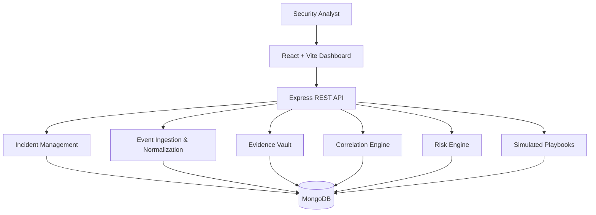

<div align="center">

# ⚒️ IncidentForge

### Incident Response & Digital Forensics Lab

**A defensive security lab for incident handling, event correlation, risk assessment, evidence tracking, and simulated response workflows.**

[Features](#-capabilities) · [Architecture](#-architecture) · [Getting Started](#-getting-started) · [API](#-api-overview) · [Security](#-security-first)


</div>

---

## 🧭 Overview

IncidentForge is a modular **blue-team / incident-response training platform** built to explore the lifecycle of a security incident: from event ingestion and triage to correlation, evidence handling, risk scoring, and response planning.

The project combines a REST API with a React dashboard and a MongoDB persistence layer. It is designed for local labs, synthetic telemetry, and controlled experimentation. Response playbooks run in **simulation mode** by default; they do not isolate endpoints, block accounts, or perform real-world containment actions.

> **Project status:** the eight planned development modules are assembled. Run the application and validate it in your own environment before relying on it. MongoDB integration and production readiness require environment-specific verification.

## 🚨 Capabilities

| Area | What it does |
|---|---|
| **Incident Management** | Create, inspect, filter, and update incidents with validated status transitions. |
| **Event Ingestion** | Normalize individual or batch events, validate input, and deduplicate using source identifiers where available. |
| **Evidence Vault** | Store evidence metadata and content, calculate SHA-256 hashes, and record chain-of-custody operations. |
| **Correlation Engine** | Identify related events using shared assets, actors, tags, event characteristics, and a time window. |
| **Risk Engine** | Produce an explainable risk score using event severity, related-event count, and correlation strength. |
| **Playbooks** | Run predefined phishing-triage and endpoint-alert workflows in simulation mode. |
| **Investigation Dashboard** | Browse incidents, events, evidence, correlations, and playbook runs from a web interface. |
| **Security Baseline** | Helmet, configurable CORS, request IDs, payload limits, rate limiting, optional API token protection, and container hardening. |

## 🧱 Architecture



### Technology stack

- **Backend:** Node.js, Express, JavaScript, Mongoose
- **Database:** MongoDB
- **Frontend:** React, Vite, JavaScript
- **Security:** Helmet, CORS controls, rate limiting, request IDs, optional shared-token middleware
- **Delivery:** Docker, Docker Compose, GitHub Actions
- **Testing:** Node.js test runner and project-specific unit tests

## 🧩 Modules

1. **Foundation & Domain Model** — configuration, database connection, health endpoint, domain models, error handling.
2. **Incident Management API** — incident lifecycle, validation, filtering, pagination, state transitions.
3. **Event Ingestion & Normalization** — normalized event schema, batch ingestion, duplicate handling.
4. **Evidence Vault & Chain of Custody** — evidence metadata, SHA-256 integrity checks, custody records.
5. **Correlation Engine** — related-event discovery with explainable matching signals.
6. **Risk Engine & Playbooks** — transparent risk scoring and simulated response workflows.
7. **Dashboard & Investigation Workflow** — React interface for reviewing operational data.
8. **Hardening, Testing & Deployment** — baseline security controls, Docker setup, CI workflow, and security notes.

## ⚙️ Getting Started

### Prerequisites

- Node.js 22 or newer
- npm
- MongoDB 7 or newer, locally or through Docker
- Git (recommended)

### Option A: Run locally

Clone the repository and enter the project directory:

```bash
git clone <YOUR_REPOSITORY_URL>
cd IncidentForge
cp .env.example .env
npm install
```

Edit `.env` and set at least a valid MongoDB connection string. Then run:

```bash
npm run check
npm test
npm run dev
```

The API defaults to `http://127.0.0.1:3000`. Health check: `GET /health`.

Start the frontend in a second terminal:

```bash
cd frontend
cp .env.example .env
npm install
npm run dev
```

Vite normally serves the dashboard at `http://localhost:5173`. Check `frontend/.env.example` for the frontend API URL setting.

### Option B: Docker Compose

Review `.env.example`, create `.env`, and use strong local secrets before starting:

```bash
cp .env.example .env
```

Set `API_ACCESS_TOKEN` to a long random value, keep CORS restricted to trusted origins, then run:

```bash
docker compose up --build
```

Stop the stack with `Ctrl+C`, or run `docker compose down`. Persistent database and evidence storage are configured through Compose volumes. Inspect `docker-compose.yml` before changing port bindings or deploying elsewhere.

### Useful commands

```bash
npm run dev       # start the API in development mode
npm run check     # JavaScript syntax checks
npm test          # run the configured test suite
```

Use the scripts actually present in `package.json` as the source of truth if the project evolves.

## 🔌 API Overview

Base URL: `http://127.0.0.1:3000`

| Resource | Typical operations |
|---|---|
| Health | `GET /health` |
| Incidents | `/api/incidents` |
| Events | `/api/events` |
| Evidence | `/api/evidence` |
| Correlations | `/api/correlations` |
| Risk assessments | `/api/risk` |
| Playbooks and runs | `/api/playbooks` |

The exact methods, request bodies, query parameters, and response shapes are defined by the route and controller files under `src/`. Review those definitions before writing integrations. When `API_ACCESS_TOKEN` is configured, API requests must include the `x-api-token` header.

### Example health check

```bash
curl http://127.0.0.1:3000/health
```

### Example event submission

Payload fields must match the event schema in the current implementation. Use this as a starting point and adjust it to the validation rules in `src/`:

```bash
curl -X POST http://127.0.0.1:3000/api/events \
  -H 'Content-Type: application/json' \
  -H 'x-api-token: YOUR_LOCAL_TOKEN' \
  -d '{
    "source": "lab-sensor",
    "sourceEventId": "demo-evt-001",
    "type": "authentication_failure",
    "severity": "medium",
    "asset": "workstation-01",
    "actor": "analyst-lab",
    "tags": ["training", "authentication"]
  }'
```

If token protection is disabled in your local configuration, omit the token header. Never commit real tokens or secrets.

## 🛡️ Security First

IncidentForge is a learning and demonstration project, not a certified incident-response product. Before exposing it to a network or using it with sensitive evidence, address these limitations:

- **Authentication and authorization:** the optional shared API token is not a substitute for individual identities, role-based access control, session management, or a complete authorization model.
- **Rate limiting:** the current in-memory limiter is process-local and resets on restart. Distributed deployments need a shared store and edge-level controls.
- **Evidence integrity:** SHA-256 hashes help detect content changes, but the application does not provide immutable/WORM storage. A privileged server or database administrator may alter evidence or custody records.
- **Playbook safety:** response actions are simulations. No real endpoint isolation, account disablement, email delivery, or network blocking is performed.
- **Deployment:** use TLS, managed secrets, restricted network access, least privilege, backups, monitoring, dependency updates, and a security review before production use.
- **Sensitive data:** use synthetic lab data by default. Do not upload real credentials, personal data, or evidence unless the environment is explicitly approved and secured for it.

See [`SECURITY.md`](SECURITY.md) for additional notes and responsible vulnerability-reporting guidance.

## 🧪 Testing and validation

Run the project's checks locally:

```bash
npm install
npm run check
npm test
```

For a full validation, also install the frontend dependencies and run its production build, start MongoDB, and exercise the API end to end. A passing unit-test suite alone does **not** prove database integration, deployment readiness, or security.

## 🗺️ Next steps

The initial eight-module roadmap is complete. Useful follow-on improvements include:

- Automated API integration tests against a disposable MongoDB instance
- User authentication, RBAC, and analyst audit trails
- Durable, tamper-evident evidence storage and retention policies
- Shared rate limiting and structured security logging
- More robust dashboard loading, empty, and error states
- Detection-rule management and synthetic event replay
- Deployment pipeline with secret scanning, dependency auditing, and image scanning

## 🤝 Contributing

Issues and pull requests are welcome. For substantial changes, open an issue first to discuss the proposal. Please include reproduction steps, tests, and any security impact in your contribution.

## 📄 License

Choose and add a license file before publishing. The `MIT` badge above should only be retained if the repository actually includes an MIT license. Replace this section with the license terms that apply to your project.

---

<div align="center">

**Built for defensive security learning, repeatable investigations, and better incident workflows.**

</div>
